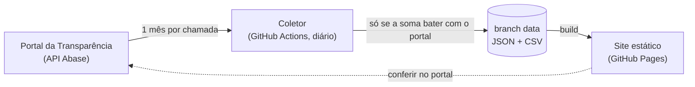

<div align="center">

<picture>
  <source media="(prefers-color-scheme: dark)" srcset="docs/brand/impostometro-rolante/assets/impostometro-rolante/mark-dark.svg">
  
</picture>

# Impostômetro Rolante

**Quanto a Prefeitura de Rolante/RS arrecada, com dado real e diário do Portal da Transparência.**

[](https://filipesfbr.github.io/impostometro-rolante/)

[](https://github.com/filipesfbr/impostometro-rolante/actions/workflows/ci.yml)


[](LICENSE)

</div>

---

## O que é

Um site que mostra quanto a Prefeitura de Rolante arrecadou no ano, de onde vem esse dinheiro e como ele se
compara ao ano anterior. **Todos os números vêm do
[Portal da Transparência da Prefeitura de Rolante](https://transparencia.abase.com.br/home/apvqyIT7vjY=)**,
e cada um tem link para conferir no próprio portal. Nada de estimativa, projeção ou contador por segundo.

Site independente, sem vínculo com a prefeitura. As regras de onde vem cada número estão em
[`docs/fonte-de-verdade.md`](docs/fonte-de-verdade.md) (R1–R9).

## O que tem

- **Arrecadado no ano**, com a data do último lançamento e da nossa coleta.
- **Orçamento:** quanto do previsto na Lei Orçamentária já entrou.
- **De onde vem o dinheiro:** o que é arrecadado em Rolante e o que é recebido da União e do Estado.
- **Tributos municipais** (ISS, IPTU, taxas, ITBI…): comparação com o mesmo período do ano anterior, gráficos
  mês a mês e acumulado, e os códigos oficiais que compõem cada um.
- **Mês a mês** e **por habitante** (estimativa populacional do IBGE).
- **De onde vêm os números:** validação da última coleta, dados para baixar (JSON e CSV), a tabela
  código → categoria e o histórico de alterações feitas pelo portal em dias já coletados.

## Como funciona

Sem servidor e sem banco:



1. Todo dia, às 06:17 de Brasília, o coletor (Node + TypeScript, sem dependências) lê os lançamentos do portal.
2. Para cada mês, a soma dos lançamentos tem de bater ao centavo com o total do portal (R2); se algum mês não
   bater, nada é publicado e o site continua na coleta anterior.
3. Os lançamentos são agregados por dia e código, sem o nome do contribuinte (R8), e as mudanças em dias já
   coletados entram no histórico (R5).
4. O resultado vai para a branch `data` (histórico público dos snapshots, R3) e o site é publicado no
   GitHub Pages.

| Pasta | O quê |
|---|---|
| `coletor/` | coleta, validação, agregação, classificação, diff e o resumo que o site lê (`site.json`) |
| `config/` | `fonte.json` (endereço, token e entidade do portal), `categorias.json` (código → categoria, R6) e `populacao-ibge.json` (última estimativa do IBGE, usada quando a API do IBGE não responde) |
| `site/` | a página (única, navegação por âncoras), em Vite + React |
| `data/` | **não fica na `main`**: é a branch `data`, gerada pelo coletor |
| `docs/` | regras da fonte de verdade e o pacote de marca (`docs/brand/`) |

## Rodar local

Node 24 (roda TypeScript direto, sem build do coletor).

```bash
npm ci
npm run coletar     # ~2 min (1 chamada a cada 2 s); grava em ./data
npm run dev         # http://localhost:5173
```

Para usar os dados publicados em vez de coletar: `git worktree add data origin/data`.

Antes de abrir PR (é o que o CI roda):

```bash
npm run lint && npm run build && npm test && npm run checks
```

Valores de referência para conferir uma coleta (portal em 26/10/2026): 2025 total R$ 134.900.191,59
(92.812 lançamentos), jan/2025 R$ 9.476.487,92, dez/2025 R$ 15.099.403,32, jan/2026 R$ 10.335.995,26,
orçado 2026 R$ 142.640.000,00.

## Dados

Na branch [`data`](../../tree/data), todos em centavos inteiros, datas `AAAA-MM-DD`:

| Arquivo | Conteúdo |
|---|---|
| `receitas/AAAA.json` · `.csv` | lançamentos somados por dia e código (sem nomes) |
| `totais/AAAA.json` | totais do portal: arrecadado, orçado, %, por mês |
| `site.json` | resumo que a página lê |
| `codigos.json` | descrição oficial de cada código |
| `historico-alteracoes.json` | mudanças em dias já coletados (R5) |
| `populacao.json` | estimativas do IBGE |
| `manifest.json` | data da coleta, validação mês a mês e SHA-256 de cada arquivo |

## Identidade visual

Família Rolante (a mesma do Câmeras Rolante): símbolo de medidor com ponteiro em terracota, fonte Inter,
fundo `#faf8f4`, tinta `#26221d` e um único acento, `#b4622f` (âmbar `#d98a52` no tema escuro). Sem sombras
nem gradientes. Os tokens ficam em [`site/src/styles/tokens.css`](site/src/styles/tokens.css), a marca entra
pelos componentes de [`site/src/components/brand/`](site/src/components/brand/), e a especificação e os
arquivos da marca estão em [`docs/brand/`](docs/brand/README.md).

## Fluxo de trabalho

Mesmo pipeline do [`workflow-test`](https://github.com/filipesfbr/workflow-test) (ler o README de lá
antes de mudar qualquer workflow):

```
PR → develop (squash) → bump automático da versão na develop
develop → main (PR, merge commit) → tag + Release → sync main → develop → deploy
```

| Workflow | Quando | O quê |
|---|---|---|
| `ci.yml` | push/PR | lint, build, test, checks |
| `bump.yml` | push na `develop` | 1 bump de versão por ciclo (minor/major: rodar na mão com `kind`) |
| `release.yml` | push na `main` | tag `vX.Y.Z` + Release; sincroniza `main → develop` |
| `deploy.yml` | push na `main`, chamado pela coleta, manual | build com a branch `data` e publica no Pages |
| `coleta.yml` | todo dia 09:17 UTC, manual | coleta → commit na `data` → deploy |

### Rodar a coleta na mão

Pelo GitHub: **Actions → Coleta diária → Run workflow** (branch `main`). Ou pelo terminal:

```bash
gh workflow run coleta.yml --ref main
gh run watch   # acompanha até terminar
```

A coleta leva cerca de 2 minutos, grava na branch `data` e publica o site em seguida. Se algum mês
não bater com o portal, nada é publicado e o site continua na coleta anterior.

O código vai por PR; os dados vão direto na `data`, pela coleta. Assim o histórico de releases fica
só com mudança de código, e o da `data` é o registro diário do que o portal mostrava.

## Configuração do repositório

1. Empurre a `main` primeiro (a primeira branch vira a default).
2. Rode `scripts/bootstrap-repo.sh filipesfbr/impostometro-rolante`: cria a `develop`, ajusta merge
   (`delete_branch_on_merge: false`, sem rebase), cria os rulesets (`main`, `develop`, `data`) e liga
   o GitHub Pages pelo Actions.
3. Rode a primeira coleta na mão: `gh workflow run coleta.yml --ref main`.

## Licença e créditos

Licença **MIT**, veja [`LICENSE`](LICENSE). Os dados são públicos e pertencem à fonte: Portal da Transparência
da Prefeitura de Rolante e IBGE.
